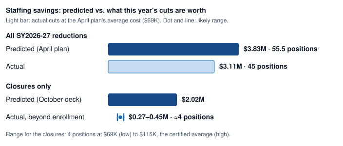
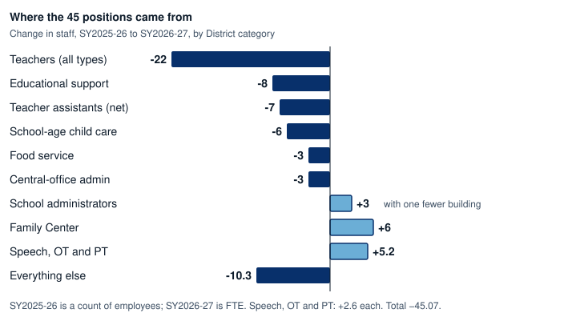
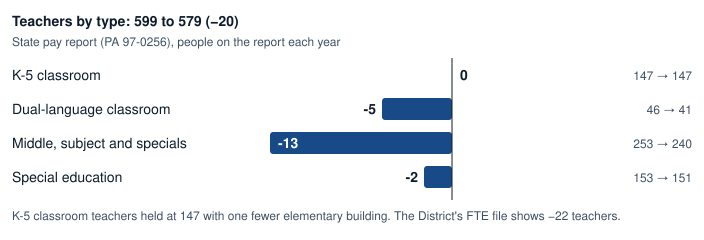

# SY26 to SY27: What Changed After Kingsley and Bessie Rhodes Closed

Kingsley and Bessie Rhodes closed at the end of SY2025-26. In October 2026 the District credited the two closures with **$3.0 million a year** in savings, **$2.0 million of it from staffing**, and proposed closing **Lincolnwood and Dewey** on the same basis. SY2026-27 staffing data is now available and allows us to compare how the actual staffing data compares to these figures.

## Summary

**The savings the District presents appear to be the cost of operating each building, not a demonstrated reduction in spending.** The per-school staffing figures line up with the cost of a building's staff: its principal and assistant principal, interventionist, librarian, nurse and other site staff. Those costs become savings only if the positions are eliminated from the district. 

We emailed Chief Financial Officer Eric Miller on October 17, 2026 to ask how the figures were built and will update this page when we hear back. 

On the data available so far, **the realized staffing savings appear to be a fraction of the $2.0 million stated: somewhere between a net cost of about $0.5 million and a net saving of about $0.2 million.** Cuts in some roles are worth up to about $0.6 million, but the district added two assistant principals and two custodians. (It is possible that more positions were cut than these data show; we will update this page as we gather more data.)

We found:

- **More principals and assistant principals, not fewer.** With one fewer building, data reported to the state (shared at the September 28, 2026 board meeting) show 30 principals and assistant principals, up from 28. Principals held at 16, while assistant principals rose from 12 to 14. We believe this reflects more schools getting an assistant principal. That raises the question of how staffing plans will change if more schools close, especially if these positions are counted as savings and then not eliminated.
- **Possible double counting.** The [October plan](https://meetings.boardbook.org/Documents/WebViewer/1247?file=14549463){:target="_blank"} counts closure staffing savings per school and also lists 103 positions under "school closures/staffing consolidation" in a separate $11.3 million staffing line. It is unclear whether the per-school closure savings are separate from, or included in, those 103 positions.
- **Cuts for the year appear minor.** Staff fell about 3%, in line with enrollment. The cuts don't move staffing toward the levels in Illinois's Evidence-Based Funding model. They also fell short of the District's own [April plan](https://meetings.boardbook.org/Documents/FileViewerOrPublic/1247?file=6407279){:target="_blank"}: 45 of the 55.5 positions it planned to cut. Certified staff came in on target (24 planned, 24 cut), but the 12 management and non-union cuts don't appear in the administrator counts, which held at 51. This raises the question of whether the District's forecasts are accurate. (The state pay reports list non-certified staff only when they earn $75,000 or more, so cuts among lower-paid support staff, such as paraprofessionals, lunchroom and child-care staff, may not appear in them; the District's FTE file covers all staff.)
- **No consolidation at K-5.** The district has exactly the same number of K-5 classroom teachers as last year: 147. Part of the case for closing schools was consolidating classes, which would reduce that number. That hasn't happened yet. Teacher reductions came elsewhere: middle school, subject and specials teachers (−13), dual-language classroom teachers (−5) and special education teachers (−2), for 20 fewer teachers in all. To be clear, we don't want to lose any teachers and are only looking to understand whether the plan to consolidate classes truly brought staffing savings.

This raises questions about **whether, and how soon,** the District can expect to realize the benefits it has attributed to these closures, and to the closures it has now proposed.

**So far, we don't have evidence that the closures save the amount forecast.**

---

## 1. What did closing two schools actually save in dollars?

The District's $3.0 million is the full cost of running each building for a year, itemized line by line in Table 6 of its [FY28 Public Financial Plan Summary](https://resources.finalsite.net/images/v1791591727/district65net/r4rpmppr8puk5ciupn1z/D65_FY28_Public_Financial_Plan_Summary2.pdf){:target="_blank"}, posted on the [D65 Data Hub](https://www.district65.net/about/budget-finance/financial-sustainability-plan){:target="_blank"}. The line items add up exactly to the [October deck's](https://meetings.boardbook.org/Documents/WebViewer/1247?file=14549463){:target="_blank"} figures: $1,008,804 and $1,006,533 of staffing, and $552,021 and $428,533 of building costs.

### Staffing: $2.0 million claimed; net result from a $0.5M cost to a $0.2M saving

The staffing figure is the cost of each building's staff. For each role, the table below shows the District's figure and how the same role changed district-wide this year.

| Role | Kingsley | Bessie Rhodes | Combined | District-wide change | Visible saving |
|---|---:|---:|---:|---|---:|
| Principal / assistant principal | $326,640 | $352,390 | $679,030 | 28 → 30 | <strong style="color:#b42318">cost $329,000</strong>† |
| Custodial support | $191,000 | $130,000 | $321,000 | Custodians +2 | <strong style="color:#b42318">cost $130,000–160,000</strong>‡ |
| Interventionist | $142,164 | $141,450 | $283,614 | 20 → 19 | up to ~$142,000 |
| Library media specialist | $85,000 | $116,004 | $201,004 | 15 → 14 | up to ~$101,000 |
| Administrative assistant | $94,000 | $60,000 | $154,000 | Clerical −2 | up to $154,000 |
| Nurse | $80,000 | $71,919 | $151,919 | Not measurable | unknown |
| Nutrition | $90,000 | $42,000 | $132,000 | Food service −3 | up to $132,000 |
| Physical education | none | $92,770 | $92,770 | PE teachers 37 → 35\* | up to $92,770 |
| **Total** | **$1,008,804** | **$1,006,533** | **$2,015,337** | | **$0.5M cost to $0.2M saving** |

\* Two PE teachers left the district, at about $72,000 each in total cost. It is unclear how that was intended to factor into these cuts.

† Two more assistant principals than last year, at the SY2026-27 average total cost for an assistant principal on the state pay report ($164,450: salary plus district-paid insurance).

‡ Two more custodians in the District's FTE file. The pay reports list custodians only above $75,000, so this uses an estimated $65,000–80,000 each.

*"Visible saving" credits every district-wide drop in a role to the closures and prices it at the District's per-school figure, so it is an upper bound: some of those drops would have happened with falling enrollment anyway. Certified roles are from the state pay reports shared at the September 28, 2026 board meeting. Custodial, clerical and food-service changes are from the District's FTE file, because the pay reports list non-certified staff only above $75,000. Nurses are on that report only above $75,000 too, so their change can't be measured.*

How the total range is built. Some roles shrank district-wide this year (interventionists, librarians, administrative assistants, nutrition and PE staff), but we can't tell whether those cuts came from the closures or would have happened anyway because enrollment fell. The **high end** (a net saving of about $0.2 million) assumes every one of those cuts came from the closures: about $622,000 in cuts, minus the roughly $459,000 cost of the added assistant principals and custodians. The **low end** (a net cost of about $0.5 million) assumes none of them did, so only the added assistant principals and custodians count, about $489,000 at the higher custodian estimate. The actual figure is likely somewhere in between.

### Building costs: $1.0 million claimed, some of it continues while the District owns the buildings

| Building cost | Combined | Likely to continue while the building is owned? |
|---|---:|---|
| Insurance | $376,211 | Yes, property insurance generally continues |
| Repairs and maintenance | $225,210 | Partly |
| Custodial supplies | $106,422 | Mostly ends |
| Electricity, natural gas and water | $135,135 | Partly (heat and power for an idle building) |
| Phone / WAN, security, building systems | $74,777 | Partly (security and alarms) |
| Copier and printing | $29,304 | Ends |
| Waste removal | $12,495 | Mostly ends |
| Discretionary supplies | $21,000 | Ends |
| **Total** | **$980,554** | **Likely saved: about $0.3–0.5 million** |

While the District owns the buildings and leaves them unused, **the likely building saving is about $0.3–0.5 million a year**, not $980,554. The low end counts only the costs that end outright (supplies, copiers, waste removal and discretionary spending, $169,221) plus a quarter of the partly continuing costs; the high end counts three quarters of them. Insurance alone is $376,211 of the $980,554. Unless the buildings are sold, leased or used for something else, that cost and part of the maintenance, utility and security costs stay on the books. The District hasn't said what will happen to the Kingsley and Bessie Rhodes buildings. We have asked the District specifically whether it still pays insurance on the closed buildings.

*The deck also cites $200,000 in transportation savings (["A Sustainable Path Forward," October 13, 2026](https://meetings.boardbook.org/Documents/WebViewer/1247?file=14549463){:target="_blank"}).*

## 2. What did closing two schools actually cut in positions?

*All reductions are valued at the [April plan](https://meetings.boardbook.org/Documents/FileViewerOrPublic/1247?file=6407279){:target="_blank"}'s average of $69,000 per position ($3.83M ÷ 55.5). The closures' actual range is the role-by-role result from section 1: cuts at the two schools' roles minus the added assistant principals and custodians.*

### Cuts mirrored the enrollment drop

K-8 enrollment fell 3.0%. Staff fell by 45 positions, against about 41 that a 3.0% drop alone would predict, which leaves **about 4 positions** beyond enrollment. That matters because the closures and this year's reductions were meant to bring staffing more in line with the number of students the District serves. The real number may be smaller than 4. Last year's figures count people, so a half-time employee counts as 1. This year's count full-time equivalents (FTE), so the same person counts as 0.5. That change in method alone makes staff look lower this year, even if no job was cut ([how the counts were made](#how-the-counts-were-made)).

### No consolidation at K-5

The District employs teachers from kindergarten through 8th grade. We focus on K-5 classroom teachers here because consolidating classes was part of the case for closing these elementary schools. We are sad to see any teacher leave; our question is only whether the plan delivered the savings it anticipated. Positions may also have been shuffled elsewhere, since cuts can come from any part of the district, but consolidating classes was a key point in the case for these closures. We do see a reduction in dual-language (TWI) classroom teachers. **K-5 classroom teachers held at exactly 147.**

**Why the K-5 count held flat.** 14 K-5 classroom teachers left the group (11 left the report and 3 moved to other roles). They were replaced by 6 new hires and 8 people who moved in from other roles. So the teaching jobs that went away were mostly in other roles, and K-5 classrooms were refilled from them.

### More principals and assistant principals

With one fewer building, principals and assistant principals went from 28 to 30 on the state report (school administrators +3 in the District's FTE file).

Moving staff from a closed school into open jobs is normal and can be a real saving, because those jobs aren't filled by new hires. But that saving shows up only as fewer positions district-wide.

### Possible double counting

The [October plan](https://meetings.boardbook.org/Documents/WebViewer/1247?file=14549463){:target="_blank"} estimates staffing savings for each school it would close (slide 35: $894,783 at Lincolnwood, $926,104 at Dewey) and counts them in a $2.9 million “District Footprint” line. A separate staffing table (slide 28) lists 6 administrators, 56 certified and 41 classified FTE (103 total) under “School Closures/Staffing Consolidation,” and the summary (slide 38) shows a separate $11.3 million “Staffing and Compensation” line. The plan does not say whether the closure staffing savings are separate from those 103 FTE or included in them. If included, the same savings are counted twice.

## 3. More evidence would create more confidence in these estimates

Building-based costs turn into savings if a position is eliminated, a vacancy is left unfilled, or a building is sold, leased or stops costing money to maintain. None of these is itemized for Kingsley or Bessie Rhodes. The district could present more data alongside the cost number showing how positions are reduced, or how insurance or maintenance costs go down when the building is empty. Without that detail, the community can't tell whether the $3.0 million is a SY2026-27 saving or an operational cost that still exists or moves with the students to another building.

The [D65: FY28 Proposed Financial Improvement Plan - Data Share](https://resources.finalsite.net/images/v1791591727/district65net/r4rpmppr8puk5ciupn1z/D65_FY28_Public_Financial_Plan_Summary2.pdf){:target="_blank"} document identifies insurance savings of $209,154 for Kingsley and $167,057 for Bessie Rhodes. The district doesn't provide details around whether this is the cost to insure a filled building, or what is the cost to insure an empty building. 

More information on how these numbers were calculated or a specific school open vs closed comparison would create more trust and accountability.

## 4. Where the District's numbers and the staffing data diverge

| | District figure | What the data show |
|---|---|---|
| Staffing saved by the two closures | $2.02M | **Between a net cost of $0.5M and a net saving of $0.2M** (cuts worth up to $0.6M, minus two added assistant principals and two added custodians) |
| Building costs saved | $0.98M | **$0.3–0.5M** (insurance, $0.38M, and part of maintenance, utilities and security continue while the buildings are owned) |
| Principals and assistant principals | $679,030 a year saved at the two schools | **No savings; about $329,000 added** (28 → 30 district-wide; all four closed-school leaders still employed) |
| K-5 consolidation | Two elementary schools closed | K-5 classroom teachers 147 → 147 |
| All SY2026-27 reductions ([April plan](https://meetings.boardbook.org/Documents/FileViewerOrPublic/1247?file=6407279){:target="_blank"}) | 55.5 positions, $3.83M, including Kingsley | 45 positions |
| Closure staffing vs. the separate staffing line | Per-school estimates | Possible overlap with 103 "consolidation" positions |
| Bessie Rhodes savings | $1.44M | Program and staff largely moved to Foster |

## 5. Data needed to answer these questions

1. How the per-school closure savings were calculated, and whether they are building costs or positions eliminated (asked of the CFO on October 17, 2026).
2. Whether insurance and other building costs continue for Kingsley and Bessie Rhodes while the District owns them (asked).
3. A staff directory, or counts of staff by job title, for SY2025-26 and SY2026-27, so specific moves can be tracked, especially for staff who earn less than $75,000 and so don't appear on the state pay reports.
4. The change in district operating costs as students and teachers from Kingsley and Bessie Rhodes joined other schools, including Foster. For example, the District counts $10,500 of discretionary supplies per closed school as a saving: did that spending go away, or did discretionary budgets rise at the schools that received more students? The same question applies to the other per-pupil and per-classroom costs that move with students.
5. Whether the Lincolnwood and Dewey staffing estimates overlap the 103 positions in the staffing line.
6. SY2025-26 staffing as FTE, so the two years are measured the same way.

---

# The detail behind these findings

## School closure timeline

| When | What | Source |
|---|---|---|
| June 10, 2024 | Board resolves to close Bessie Rhodes effective July 1, 2026 (after SY2025-26) and move its K-5 TWI program to the new Fifth Ward school (Foster). The District later noted this decision was "not driven by" the deficit-reduction (SDRP) process. | [Resolution (June 10, 2024)](https://meetings.boardbook.org/Documents/FileViewerOrPublic/1247?file=6406456){:target="_blank"}; [April 13, 2026 presentation, slide 2](https://meetings.boardbook.org/Documents/FileViewerOrPublic/1247?file=6407279){:target="_blank"} |
| January 22, 2026 | Board votes 6-0 to close Kingsley after SY2025-26, following a January 9 resolution to hold public hearings. | [Closure resolution (Jan 22, 2026)](https://meetings.boardbook.org/Documents/FileViewerOrPublic/1247?file=6407169){:target="_blank"}; [Hearings resolution (Jan 9, 2026)](https://meetings.boardbook.org/Documents/FileViewerOrPublic/1247?file=6407164){:target="_blank"} |
| April 13, 2026 | SY2026-27 reduction plan: 55.5 net positions, $3.83M. "School-level reductions are reflective of declining student enrollment and the closure of Kingsley Elementary." | [D65 Agendas & Minutes](https://meetings.boardbook.org/Documents/FileViewerOrPublic/1247?file=6407279){:target="_blank"} |
| Fall 2026 | Kingsley and Bessie Rhodes closed; Foster School opens. Net change: one fewer elementary building. | |
| September 28, 2026 | FY27 budget adopted; reflects "an estimated $6.3 million in expenditure reductions approved by the Board last spring, including staffing reductions, school closures, and other operational changes." | [FY27 Final Budget Memo](https://meetings.boardbook.org/Documents/FileViewerOrPublic/1247?file=14472808){:target="_blank"} |
| October 13, 2026 | "A Sustainable Path Forward" deck: Kingsley and Bessie Rhodes closures estimated at $3.0M a year combined; proposes closing Lincolnwood and Dewey using the same method. | [D65 Agendas & Minutes](https://meetings.boardbook.org/Documents/WebViewer/1247?file=14549463){:target="_blank"} |

**What the District says the two closures save ([October 13, 2026 deck](https://meetings.boardbook.org/Documents/WebViewer/1247?file=14549463){:target="_blank"}):**

| | Kingsley | Bessie Rhodes | Combined |
|---|---:|---:|---:|
| Staffing | $1,008,804 | $1,006,533 | $2,015,337 |
| Building and operating costs | $462,036 | $383,383 | $845,419 |
| Utilities | $89,985 | $45,150 | $135,135 |
| **Estimated gross annual savings** | **$1,560,825** | **$1,435,066** | **$2,995,891** |

The [deck](https://meetings.boardbook.org/Documents/WebViewer/1247?file=14549463){:target="_blank"} adds "$200,000 in transportation savings" from the two closures, and states that prior estimates were "$1.4M each."

---

## Enrollment

| | SY2025-26 | SY2026-27 | Change |
|---|---:|---:|---:|
| K-8 students (excluding Park, Rice and JEH) | 5,630 | 5,462 | −168 (−3.0%) |

*SY2025-26 from the District's November 2025 enrollment memo; SY2026-27 from the District's public dashboard, pulled September 23, 2026 (preliminary until the November memo). Building-by-building enrollment and utilization are on [SY27 Building Use and Closure Costs](sy27_building_use).*

---

## Staffing: what the District's counts show

<iframe src="assets/sy26_sy27_fte_change.html" width="100%" height="800" frameborder="0"></iframe>

| Group | SY2025-26 | SY2026-27 | Change | % change |
|---|---:|---:|---:|---:|
| Certified (teachers, specialists, counselors, others in the DEC union) | 761 | 736.93 | −24.07 | −3.2% |
| Administrators (central office, cabinet, superintendent, school administrators) | 51 | 51 | 0 | 0% |
| All other staff | 569 | 548 | −21 | −3.7% |
| **Total** | **1,381** | **1,335.93** | **−45.07** | **−3.3%** |

*Every category, with the District's descriptions: [data/sy26_sy27_fte_by_category.csv](data/sy26_sy27_fte_by_category.csv). "TA" fell by 14 but 7 teacher assistants moved to a new "TA SIGN" code, so the net change is −7.*

**Where the reductions landed:**

- **Teachers: −22.17.** This is the District's "Certified Staff - Teachers" category alone (635 → 612.83) and the largest single change. All certified categories together fell 24.07, close to the plan's 24 DEC reductions. That total is teachers −22.17, other certified staff −4, guidance counselors −2, instructional coaches −1 and social workers −0.1, partly offset by speech-language pathologists +2.6 and occupational/physical therapists +2.6. Part of the teacher figure may reflect the change from a count of employees to FTE (see [How the counts were made](#how-the-counts-were-made)).
- **Educational support staff (−8), teacher assistants (−7, net) and school-age child care (−6)** account for most of the rest.
- **Some categories grew:** school administrators (+3), Family Center staff (+6, doubling), speech-language pathologists (+2.6) and occupational/physical therapists (+2.6).

**Compared with the District's [April plan](https://meetings.boardbook.org/Documents/FileViewerOrPublic/1247?file=6407279){:target="_blank"}.** The April plan reported its 55.5 reductions by union, not by employee category, so the match is approximate:

| [April 13, 2026 plan](https://meetings.boardbook.org/Documents/FileViewerOrPublic/1247?file=6407279){:target="_blank"} (by union) | Planned | Closest categories in the October 2026 file | Observed |
|---|---:|---|---:|
| DEC (teachers and other certified staff) | −24 | All certified categories | −24.07 |
| ETAA (teacher assistants) | −10 | TA + TA SIGN | −7 |
| EACCP (child-care staff) | −4.5 | SACC, child-care teaching assistants, child-care support staff | −9 |
| ECMA (management) and non-union | −12 | Administrator categories | 0 |
| DESC (secretarial and clerical) | −5 | Admin assistants, health clerks, techs | −2 |
| **Total** | **−55.5** | All categories | **−45.07** |

*The observed column adds to −42.07; categories with no clear union match make up the rest. These include educational support staff (−8), food service (−3), Family Center staff (+6), custodians (+2) and the new SIGN code (+1).*

---

## Administrators after two closures

**Which "administrators"?** The District's FTE file (used on the [Staff Data](staff-data) page) and the state salary report (used on the [Salary Data](salary-data) page) define the group differently:

| | FTE file (Staff Data) | State report (Salary Data) |
|---|---|---|
| Central-office administrators | 23 → 20 | 24 → 21 |
| Principals and assistant principals | 28 → 31, counted as administrators | 28 → 30, counted separately |
| IES and other coordinators, union president | Not counted as administrators | 12 → 9, counted as administrators |
| **Headline** | **51 → 51** | **36 → 30** |

Both show central office down 3. The FTE total holds at 51 because school administrators rose by 3. The salary count falls by 6 because it also includes 3 fewer coordinators and leaves principals out.

Closing a school should remove one principal's job and, often, an assistant principal's. Instead, all four leaders are still school administrators, and the District's count of school administrators rose by 3. The [deck](https://meetings.boardbook.org/Documents/WebViewer/1247?file=14549463){:target="_blank"} doesn't break down the roughly $1.0 million in staffing savings per closure. A closed school's principal and assistant principal would ordinarily be part of it, and those savings don't appear in the District's administrator counts. **The [Admin Growth update](admin-growth-final#october-2026-update-sy2026-27-data-and-the-districts-new-plan) covers the central-office side and the District's claim that administrators were cut 36%. That 36% is the change in a ratio, students per administrator going from 90 to 140, not a count of people, and the ratio also rises when enrollment falls. By the District's counts, the cut is 20–25%, and none of it came this year.**

---

## How the counts were made

- **Staff by category.** SY2025-26 is the District's table of employees by category as published by Larry Gavin in the [Evanston RoundTable](https://evanstonroundtable.com/2025/11/02/guest-essay-district-65-employees-enrollment/){:target="_blank"} (Nov. 2, 2025, Table 2). That table is labeled **"COUNTA"**, a *count of employees*, and every value is a whole number. SY2026-27 is the District's "FTEs by Employee Category" file (October 2026), a **sum of FTE** with fractional values (for example, 612.83 teachers). A part-time employee counts as 1 in the first year and as a fraction in the second. Part of the 45-position drop may therefore come from the change in measure rather than from fewer people. The District should provide both years on the same basis.
- **Groups.** Certified = the CERT categories; administrators = ADMIN, ADMIN SCHOOL, CABINET (called COUNCIL in SY2025-26) and SUPT; all other categories are "all other staff." These reproduce the District's SY2025-26 group totals (761, 51, 569).
- **Compensation reports** are the District's PA 97-0256 reports: [SY2025-26](../assets/Administrator%20and%20Teacher%20FY26.pdf){:target="_blank"} and [SY2026-27](../assets/Administrator%20and%20Teacher%20FY27.pdf){:target="_blank"}, converted by [convert_pa_pdfs.py](convert_pa_pdfs.py).
- **Enrollment** is K-8 excluding Park, Rice and JEH, the measure used throughout this site: 5,630 in SY2025-26 (the District's November 2025 enrollment memo) and 5,462 in SY2026-27 (the District's public dashboard, pulled September 23, 2026, preliminary until the November memo). Building-by-building enrollment is on [SY27 Building Use and Closure Costs](sy27_building_use).
- **Everything is rebuilt by** [build_sy26_sy27_comparison.py](build_sy26_sy27_comparison.py).

*Related analyses: [Admin Growth](admin-growth-final) (including the October 2026 update), [Salary Data](salary-data), [Staff Data](staff-data), and [SY27 Building Use and Closure Costs](sy27_building_use).*
