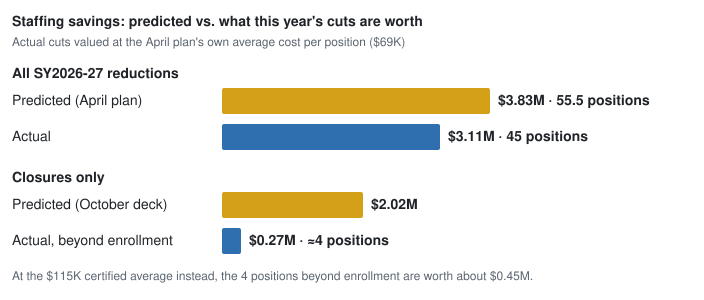

# SY26 to SY27: What Changed After Kingsley and Bessie Rhodes Closed

*Legion of Data Nerds · October 2026 · Preliminary: based on the District's October 2026 staffing file, the SY2026-27 state compensation reports, and fall 2026 enrollment.*

Kingsley and Dr. Bessie Rhodes closed at the end of SY2025-26. In October 2026 the District credited the two closures with **$3.0 million a year** in savings, **$2.0 million of it from staffing**, and proposed closing **Lincolnwood and Dewey** on the same basis.

SY2026-27 is the first year after the closures, so it's the first chance to check the staffing claim against the District's own staff counts and the state pay reports. This page asks one question: **if the closures saved $2.0 million a year in staffing, does it show up in this year's staff?**

## Summary

**Not yet, on the data available.** Staff fell by about as much as enrollment did. Both of Kingsley's leaders and most of its teachers are still employed. Bessie Rhodes's program moved to Foster largely intact. The District may have savings these numbers can't show, but it hasn't published the position-level detail that would show them.

---

## 1. What the District says

| | Kingsley | Bessie Rhodes | Combined |
|---|---:|---:|---:|
| Staffing | $1,008,804 | $1,006,533 | **$2,015,337** |
| Building, operating and utilities | $552,021 | $428,533 | $980,554 |
| **Estimated annual savings** | **$1,560,825** | **$1,435,066** | **$2,995,891** |

*"A Sustainable Path Forward," October 13, 2026 ([FOIA Gras doc 24535](https://ig.foiagras.com/api/public/chat/documents/24535/view){:target="_blank"}). The deck also cites $200,000 in transportation savings. The building savings can't be checked until FY27 actuals are out, so this page covers staffing.*

## 2. What we'd expect to see if the claim holds

A staffing saving means positions that would otherwise exist and no longer do. Most of them should show up in at least one of three places:

- **Staff falling faster than enrollment.** Enrollment decline cuts positions on its own. Closure savings would come on top of that.
- **Fewer school leaders.** A closed school no longer needs a principal and, usually, an assistant principal.
- **Fewer people on the payroll from the closed schools.**

## 3. What the data show

**Staff fell about as much as enrollment.** K-8 enrollment fell 3.0%. Staff fell by 45 positions, against about 41 that a 3.0% drop alone would predict. That leaves **about 4 positions** beyond enrollment, and possibly fewer, because last year was counted in employees and this year in FTE ([how the counts were made](#how-the-counts-were-made)). At the average certified cost of $115,000, $2.0 million is **about 17 positions**.

**Teachers, counted separately, show the same pattern.** On the state pay report, classroom, subject, special education and dual-language teachers went from 599 to 579, a cut of 20 (chart below). Enrollment alone predicts about 18, so about **2 teachers** were cut beyond enrollment. K-5 classroom teachers held at 147, even with one fewer elementary building. Most of the cut came from middle school, subject and specials teachers (−13) and dual-language classrooms (−5). The average teacher cost ($114,000) is almost the same as the certified average, so $2.0 million would be about 17 to 18 teachers.

*Actual cuts are valued at the April plan's own average of $69,000 per position ($3.83M ÷ 55.5).*

**Most of the cuts were teachers. School administrators went up.** With one fewer building, school administrators rose by 3. On the state report, principals and assistant principals went from 28 to 30.

**The closed schools' leaders and teachers are still employed.** All four of Kingsley's and Rhodes's principals and assistant principals hold the same kind of job this year. 25 of Kingsley's 28 certified staff and 27 of Rhodes's 28 are still on the payroll, in line with or above the district as a whole (89%).

Moving staff from a closed school into open jobs is normal and can be a real saving, because those jobs aren't filled by new hires. But that saving shows up only as fewer positions district-wide, and the drop beyond enrollment is about 4.

## 4. Bessie Rhodes is a move, not a closure

Rhodes's K-5 dual-language (TWI) program moved to the new Foster School with its principal and most of its teachers. The deck books $1.0 million of Rhodes staffing savings and $0.43 million of building savings. It shows no cost for running Foster. For Rhodes, the saving is the old building's costs minus the new building's, and that figure isn't in the deck.

## 5. Where the District's own numbers don't line up

| | District figure | What the data show |
|---|---|---|
| Staffing saved by the two closures | $2.0M (about 17 positions) | About 4 positions cut beyond enrollment |
| All SY2026-27 reductions (April plan) | 55.5 positions, $3.83M, including Kingsley | 45 positions |
| Closure staffing vs. the April total | $2.0M of $3.83M from closures | The closures would be more than half of all reductions, with no visible drop beyond enrollment |
| School administrators | Closures should reduce them | +3 district-wide |
| Rhodes savings | $1.44M, no Foster offset | Program and staff moved to Foster |

## 6. Why it matters now

The October deck uses the same method to price **Lincolnwood ($1.42M) and Dewey ($1.48M)**, with $0.89M and $0.93M of it from staffing. It also lists 103 positions under "school closures/staffing consolidation" in a separate $11.3M staffing line. If the closing schools' positions appear in both, the savings are counted twice.

## 7. What the District could publish

1. A position-level list of SY2026-27 reductions by school and category, marking which are credited to the closures and which to enrollment.
2. Where the Kingsley and Rhodes principals, assistant principals and specialists were assigned, and which positions were eliminated.
3. Foster's operating cost, and the net Rhodes saving after that cost.
4. SY2025-26 staffing as FTE, so the two years are measured the same way.
5. The positions behind the Lincolnwood and Dewey staffing estimates, and whether they overlap the 103 positions in the staffing line.

---

# The detail behind these findings

## What changed: the timeline

| When | What | Source |
|---|---|---|
| June 10, 2024 | Board resolves to close Bessie Rhodes after SY2025-26 and move its K-5 TWI program to the new Fifth Ward school (Foster). The District later noted this decision was "not driven by" the deficit-reduction (SDRP) process. | [FOIA Gras doc 794](https://ig.foiagras.com/api/public/chat/documents/794/view){:target="_blank"}; [doc 21784](https://ig.foiagras.com/api/public/chat/documents/21784/view){:target="_blank"} |
| January 9, 2026 | Board resolves to close Kingsley after SY2025-26. | [FOIA Gras doc 13846](https://ig.foiagras.com/api/public/chat/documents/13846/view){:target="_blank"} |
| April 13, 2026 | SY2026-27 reduction plan: 55.5 net positions, $3.83M. "School-level reductions are reflective of declining student enrollment and the closure of Kingsley Elementary." | [FOIA Gras doc 21784](https://ig.foiagras.com/api/public/chat/documents/21784/view){:target="_blank"} |
| Fall 2026 | Kingsley and Rhodes closed; Foster School opens. Net change: one fewer elementary building. | |
| September 28, 2026 | FY27 budget adopted; reflects "an estimated $6.3 million in expenditure reductions approved by the Board last spring, including staffing reductions, school closures, and other operational changes." | [FOIA Gras doc 24492](https://ig.foiagras.com/api/public/chat/documents/24492/view){:target="_blank"} |
| October 13, 2026 | "A Sustainable Path Forward" deck: Kingsley and Rhodes closures estimated at $3.0M a year combined; proposes closing Lincolnwood and Dewey using the same method. | [FOIA Gras doc 24535](https://ig.foiagras.com/api/public/chat/documents/24535/view){:target="_blank"} |

**What the District says the two closures save (October 13, 2026 deck):**

| | Kingsley | Bessie Rhodes | Combined |
|---|---:|---:|---:|
| Staffing | $1,008,804 | $1,006,533 | $2,015,337 |
| Building and operating costs | $462,036 | $383,383 | $845,419 |
| Utilities | $89,985 | $45,150 | $135,135 |
| **Estimated gross annual savings** | **$1,560,825** | **$1,435,066** | **$2,995,891** |

The deck adds "$200,000 in transportation savings" from the two closures, and states that prior estimates were "$1.4M each."

---

## Enrollment

| | SY2025-26 | SY2026-27 | Change |
|---|---:|---:|---:|
| K-8 students (excluding Park, Rice and JEH) | 5,630 | 5,462 | −168 (−3.0%) |

*SY2025-26 from the District's November 2025 enrollment memo; SY2026-27 from the District's public dashboard, pulled September 23, 2026 (preliminary until the November memo). Building-by-building enrollment and utilization are on [SY27 Building Use and Closure Costs](sy27_building_use).*

---

## Staffing: what the District's own counts show

<iframe src="assets/sy26_sy27_fte_change.html" width="100%" height="800" frameborder="0"></iframe>

| Group | SY2025-26 | SY2026-27 | Change | % change |
|---|---:|---:|---:|---:|
| Certified (teachers, specialists, counselors, others in the DEC union) | 761 | 736.93 | −24.07 | −3.2% |
| Administrators (central office, cabinet, superintendent, school administrators) | 51 | 51 | 0 | 0% |
| All other staff | 569 | 548 | −21 | −3.7% |
| **Total** | **1,381** | **1,335.93** | **−45.07** | **−3.3%** |

*Every category, with the District's own descriptions: [data/sy26_sy27_fte_by_category.csv](data/sy26_sy27_fte_by_category.csv). "TA" fell by 14 but 7 teacher assistants moved to a new "TA SIGN" code, so the net change is −7.*

**Where the reductions landed:**

- **Teachers: −22.17.** This is the District's "Certified Staff - Teachers" category alone (635 → 612.83) and the largest single change. All certified categories together fell 24.07, close to the plan's 24 DEC reductions. That total is teachers −22.17, other certified staff −4, guidance counselors −2, instructional coaches −1 and social workers −0.1, partly offset by speech-language pathologists +2.6 and occupational/physical therapists +2.6. Part of the teacher figure may reflect the change from a count of employees to FTE (see [How the counts were made](#how-the-counts-were-made)).
- **Educational support staff (−8), teacher assistants (−7, net) and school-age child care (−6)** account for most of the rest.
- **Some categories grew:** school administrators (+3), Family Center staff (+6, doubling), speech-language pathologists (+2.6) and occupational/physical therapists (+2.6).

**Compared with the District's April plan.** The April plan reported its 55.5 reductions by union, not by employee category, so the match is approximate:

| April 13, 2026 plan (by union) | Planned | Closest categories in the October 2026 file | Observed |
|---|---:|---|---:|
| DEC (teachers and other certified staff) | −24 | All certified categories | −24.07 |
| ETAA (teacher assistants) | −10 | TA + TA SIGN | −7 |
| EACCP (child-care staff) | −4.5 | SACC, child-care teaching assistants, child-care support staff | −9 |
| ECMA (management) and non-union | −12 | Administrator categories | 0 |
| DESC (secretarial and clerical) | −5 | Admin assistants, health clerks, techs | −2 |
| **Total** | **−55.5** | All categories | **−45.07** |

*The observed column adds to −42.07; categories with no clear union match make up the rest. These include educational support staff (−8), food service (−3), Family Center staff (+6), custodians (+2) and the new SIGN code (+1).*

Certified staff came in almost exactly as planned. The management reductions do not show up in the administrator categories, which held at 51. Some ECMA and non-union positions may sit in other categories, so this is the comparison the District should be able to settle with a position-level list.

---

## Administrators after two closures

> **Which "administrators"?** The District's FTE file (used on the [Staff Data](staff-data) page) and the state salary report (used on the [Salary Data](salary-data) page) define the group differently:
>
> | | FTE file (Staff Data) | State report (Salary Data) |
> |---|---|---|
> | Central-office administrators | 23 → 20 | 24 → 21 |
> | Principals and assistant principals | 28 → 31, counted as administrators | 28 → 30, counted separately |
> | IES and other coordinators, union president | Not counted as administrators | 12 → 9, counted as administrators |
> | **Headline** | **51 → 51** | **36 → 30** |
>
> Both show central office down 3. The FTE total holds at 51 because school administrators rose by 3. The salary count falls by 6 because it also includes 3 fewer coordinators and leaves principals out.

**The closed schools' leaders.** In December 2025, Kingsley and Rhodes each had a principal and an assistant principal. Matching them by name to the SY2026-27 state report:

| | Kingsley | Bessie Rhodes |
|---|---|---|
| Principal | Still a principal | Still a principal |
| Assistant principal | Still an assistant principal | Still an assistant principal (listed under a new last name) |

Closing a school should remove one principal's job and, often, an assistant principal's. Instead, all four leaders are still school administrators, and the District's count of school administrators rose by 3. The deck doesn't break down the roughly $1.0 million in staffing savings per closure. A closed school's principal and assistant principal would ordinarily be part of it, and those savings don't appear in the District's administrator counts. The [Admin Growth update](admin-growth-final#october-2026-update-sy2026-27-data-and-the-districts-new-plan) covers the central-office side and the District's claim that administrators were cut 36%. On the District's own counts, the cut is 20–25%, and none of it came this year.

---

## The closed schools' staff

Of the certified staff listed at each school in the December 2025 staff directory, the share still on the District's certified salary report in SY2026-27:

| | Kingsley | Bessie Rhodes | District-wide |
|---|---:|---:|---:|
| Certified staff in SY2025-26 | 28 | 28 | 821 |
| Still on the certified report in SY2026-27 | 25 (89%) | 27 (96%) | 733 (89%) |

*Matched by name between the December 2025 [staff directory](staff-data) and the PA 97-0256 reports for SY2025-26 and SY2026-27. Non-certified staff (17 at each school: paraprofessionals, lunchroom, child care, custodial) are not on a public roster with pay, so they can't be traced. Aggregate counts in [data/sy26_sy27_closed_school_staff.csv](data/sy26_sy27_closed_school_staff.csv).*

Staff from the closed schools stayed on at the same rate as everyone else. That is not a failure in itself: a district would normally move teachers from a closed school into openings elsewhere. But it means **any staffing savings have to show up as fewer positions district-wide.** Certified positions fell 3.2%, about the same as enrollment.

**Bessie Rhodes is a special case.** Its K-5 TWI program moved to Foster, and most of its teachers moved with it. Several have the same "TWI" grade-level titles this year. The October deck still books $1.0 million of Rhodes "staffing" savings and $0.43 million of building and utility savings, and shows no offsetting cost for running Foster. A program that moves to a new building with most of its staff saves the old building's costs, minus the new building's. That calculation is not in the deck. Our [SY27 Building Use and Closure Costs](sy27_building_use) page lists "itemized savings from the Kingsley and Bessie Rhodes closures … net of the costs of opening Foster" among the data the District should provide.

---

## Pay: certified payroll went up

From the District's PA 97-0256 reports (all teachers, principals and other certified staff):

| | SY2025-26 | SY2026-27 | Change |
|---|---:|---:|---:|
| People on the report | 821 | 800 | −21 |
| Total compensation | $94.53M | $96.96M | **+$2.43M (+2.6%)** |
| Average base salary | $93,824 | $97,532 | +4.0% |
| Median raise, same person | | | **+5.6%** |

*Total compensation is salary plus retirement contribution, insurance, bonus and annuities. Built by [build_sy26_sy27_comparison.py](build_sy26_sy27_comparison.py); summary in [data/sy26_sy27_certified_payroll.csv](data/sy26_sy27_certified_payroll.csv). Role-by-role detail is on the [Salary Data](salary-data) page.*

Raises are not a reason to doubt closure savings, which are measured against what the District would otherwise have spent. But they explain why the budget does not shrink even when positions do. The April plan assumed "~5% annual salary growth, driven by bargained labor agreements," and that alone outweighs this year's position reductions in the certified payroll.

---

## How the counts were made

- **Staff by category.** SY2025-26 is the District's table of employees by category as published by Larry Gavin in the [Evanston RoundTable](https://evanstonroundtable.com/2025/11/02/guest-essay-district-65-employees-enrollment/){:target="_blank"} (Nov. 2, 2025, Table 2). That table is labeled **"COUNTA"**, a *count of employees*, and every value is a whole number. SY2026-27 is the District's "FTEs by Employee Category" file (October 2026), a **sum of FTE** with fractional values (for example, 612.83 teachers). A part-time employee counts as 1 in the first year and as a fraction in the second. Part of the 45-position drop may therefore come from the change in measure rather than from fewer people. The District should provide both years on the same basis. FY24–FY26 totals in Table 1 of the same article are whole numbers too, while FY19–FY23 have decimals. That suggests the District may have changed its counting method around FY24, which deserves a question of its own.
- **Groups.** Certified = the CERT categories; administrators = ADMIN, ADMIN SCHOOL, CABINET (called COUNCIL in SY2025-26) and SUPT; all other categories are "all other staff." These reproduce the District's SY2025-26 group totals (761, 51, 569).
- **Compensation reports** are the District's PA 97-0256 reports: [SY2025-26](../assets/Administrator%20and%20Teacher%20FY26.pdf){:target="_blank"} and [SY2026-27](../assets/Administrator%20and%20Teacher%20FY27.pdf){:target="_blank"}, converted by [convert_pa_pdfs.py](convert_pa_pdfs.py).
- **Name matching** uses last name and first given name. It also links surname changes: same first name, a shared part of the surname (for example, a hyphenated name added or dropped), and no other match on either side. Four were found district-wide, all in the same job both years, including Bessie Rhodes's assistant principal. A complete surname change would still show as a departure. That would lower the closed-school and district-wide rates alike, so the comparison between them holds.
- **Enrollment** is K-8 excluding Park, Rice and JEH, the measure used throughout this site. SY2026-27 is preliminary.
- **Everything is rebuilt by** [build_sy26_sy27_comparison.py](build_sy26_sy27_comparison.py).

*Related analyses: [Admin Growth](admin-growth-final) (including the October 2026 update), [Salary Data](salary-data), [Staff Data](staff-data), and [SY27 Building Use and Closure Costs](sy27_building_use).*
